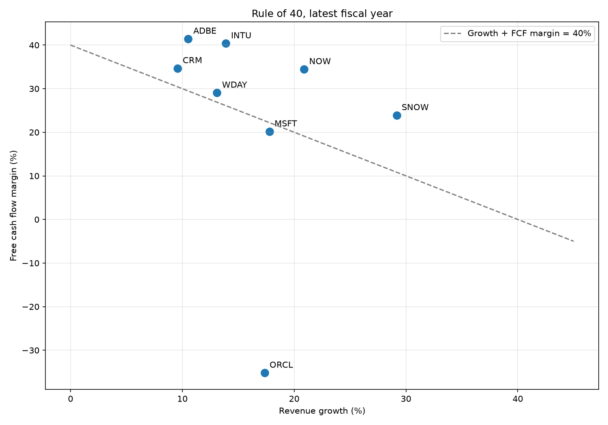
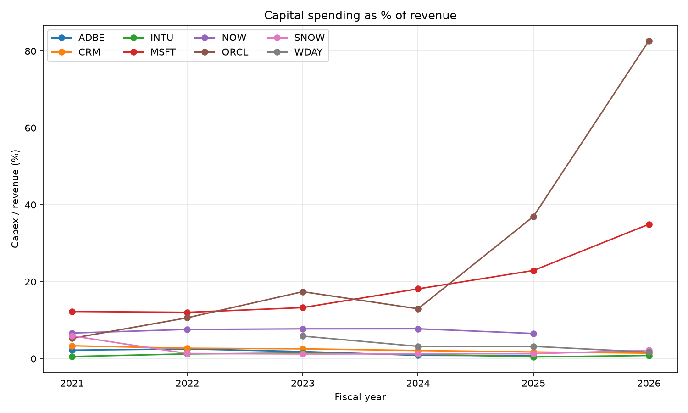
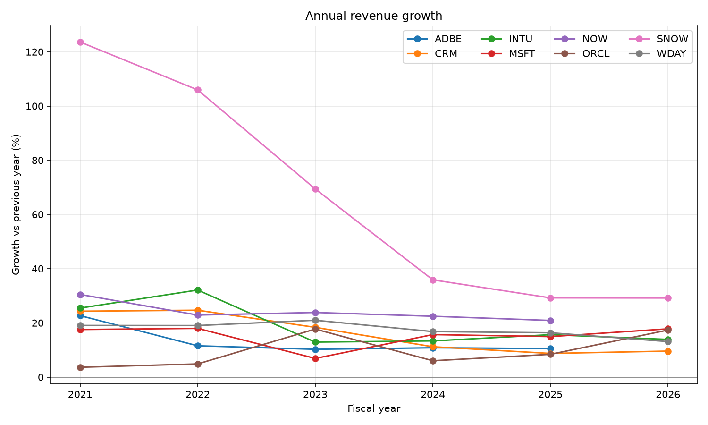
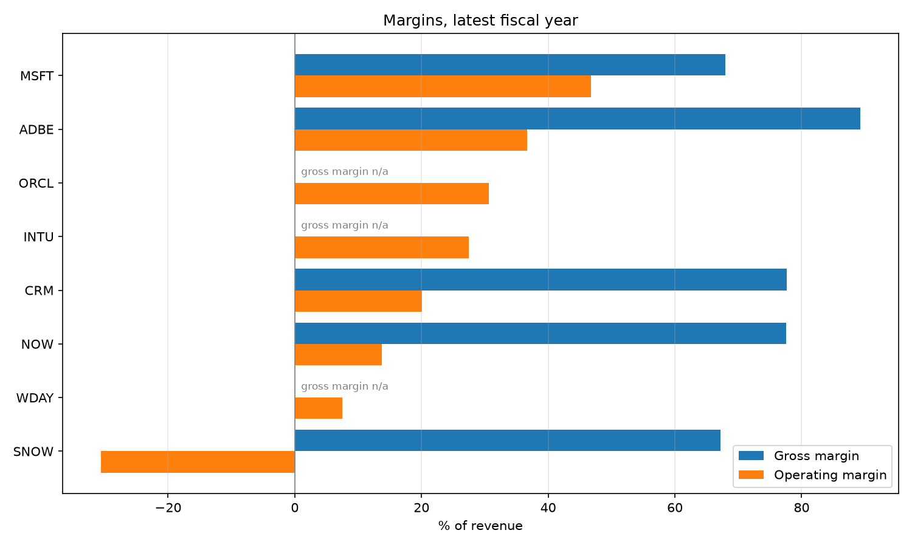

# Tech Software Sector Analysis

A Python project comparing the financial performance of eight large US-listed
software companies using official data from their annual reports (10-K filings)
published by the SEC.

**Companies:** Microsoft (MSFT), Oracle (ORCL), Adobe (ADBE), Salesforce (CRM),
ServiceNow (NOW), Intuit (INTU), Workday (WDAY), Snowflake (SNOW)

## Questions

1. Which companies are growing revenue fastest, and is growth speeding up or slowing down?
2. How profitable is each business (gross and operating margin)?
3. Which companies pass the **Rule of 40**, a common test for software businesses?

## Key metrics

| Metric | Formula | What it tells you |
|---|---|---|
| Revenue growth | revenue ÷ last year's revenue − 1 | How fast the business is growing |
| Gross margin | gross profit ÷ revenue | How much of each sale is left after the direct cost of providing the product |
| Operating margin | operating income ÷ revenue | Profit after all running costs (staff, R&D, sales) |
| Free cash flow (FCF) margin | (operating cash flow − capital spending) ÷ revenue | Cash actually generated per dollar of revenue |
| Rule of 40 | revenue growth % + FCF margin % | A score of 40%+ suggests a healthy balance of growth and profitability |

## Findings

_Latest annual reports available on 14 October 2026._

| Company | Fiscal year | Revenue ($bn) | Growth | Gross margin | Operating margin | FCF margin | Rule of 40 |
|---|---|---|---|---|---|---|---|
| ServiceNow (NOW) | 2025 | 13.3 | 20.9% | 77.5% | 13.7% | 34.5% | **55.3** |
| Intuit (INTU) | 2026 | 21.4 | 13.9% | n/a | 27.4% | 40.4% | **54.3** |
| Snowflake (SNOW) | 2026 | 4.7 | 29.2% | 67.2% | −30.6% | 23.9% | **53.1** |
| Adobe (ADBE) | 2025 | 23.8 | 10.5% | 89.3% | 36.6% | 41.4% | **52.0** |
| Salesforce (CRM) | 2026 | 41.5 | 9.6% | 77.7% | 20.1% | 34.7% | **44.3** |
| Workday (WDAY) | 2026 | 9.6 | 13.1% | n/a | 7.5% | 29.1% | **42.2** |
| Microsoft (MSFT) | 2026 | 331.8 | 17.8% | 67.9% | 46.8% | 20.2% | 38.0 |
| Oracle (ORCL) | 2026 | 67.4 | 17.3% | n/a | 30.6% | −35.2% | −17.8 |

**1. Six of the eight companies pass the Rule of 40.** ServiceNow scores highest
(55.3), combining 21% growth with a 35% free cash flow margin.



**2. AI infrastructure spending explains the two that don't.** Microsoft has the
highest operating margin in the group (46.8%), but its capital spending rose from
12% of revenue in fiscal 2021 to 35% in fiscal 2026 as it built data centres. That
pulls its free cash flow margin down to 20% and its score just under 40. Oracle is
more extreme: capital spending reached 83% of revenue ($55.7bn on $67.4bn of
revenue), so free cash flow turned negative. Both are trading cash today for
capacity they expect to sell later. The Rule of 40 alone can't tell you whether
that bet will pay off.



**3. Growth has slowed across the sector, with Oracle as the exception.**
Snowflake is still the fastest-growing company, but its growth fell from 124% in
fiscal 2021 to 29% in fiscal 2026. Most others have settled between 10% and 20%.
Oracle went the other way, from 4% growth in fiscal 2021 to 17% in fiscal 2026.



**4. Accounting profit and cash can tell different stories.** Snowflake makes an
operating loss of −31% of revenue but a positive free cash flow margin of 24%. The
gap is mainly non-cash costs, such as paying staff in shares, which reduce
reported profit but not cash. Adobe has the highest gross margin (89%), meaning
very little of each sale goes on the direct cost of delivering its products.



## How to run

Requires Python 3.10+.

```bash
pip install -r requirements.txt
```

The SEC asks every script to identify itself with a name and email:

```bash
export SEC_USER_AGENT="Your Name your.email@example.com"
```

(On Windows PowerShell: `$env:SEC_USER_AGENT = "Your Name your.email@example.com"`)

```bash
python src/fetch_data.py
python src/analyse.py
```

This creates `data/financials.csv` (raw figures), `data/summary.csv` (latest-year
ratios) and the charts in `charts/`.

## Method and limitations

- Data comes from the free [SEC EDGAR companyfacts API](https://www.sec.gov/search-filings/edgar-application-programming-interfaces).
  Only full-year figures from 10-K reports are used; where a figure was later
  restated, the most recent version is used.
- Companies have different fiscal years (e.g. Microsoft's ends in June,
  Salesforce's in January). Each year is labelled by the calendar year it ends in,
  so "2025" doesn't cover exactly the same months for every company. Adobe and
  ServiceNow's latest year is 2025 because their 2026 fiscal years haven't ended yet.
- Gross margin is shown as n/a for Oracle, Intuit and Workday. Oracle doesn't
  report gross profit, and Intuit and Workday don't report a single cost-of-revenue
  total in the data the SEC API provides.
- Growth includes acquisitions, so it isn't purely organic growth.
- Capital spending only includes property and equipment, not capitalised software.
- This is a learning project, not investment advice.

## Tools

Python, pandas, matplotlib, requests
